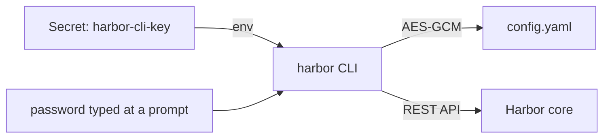

# Contexts And The Encryption Key

A script that talks to Harbor needs credentials, and it needs somewhere safe to keep them. If the credentials sit in plain text in the script or in the process list, anyone who can read the CI log can use them. The `harbor` command-line tool (CLI) solves this by saving each sign-in as a context and by encrypting the saved password. This part shows what a context holds, where the CLI stores it, and where the encryption key comes from when the CLI runs in a container.

## Where the CLI keeps its sign-in

The CLI does not ask for a password on every command. It signs in once and saves the result as a **context**: a name, the Harbor server address, the user name and the password. All contexts live in one configuration file, by default `~/.config/harbor-cli/config.yaml`, and one of them is the current context that every command uses.

The workstation pod already has one context, called `admin`, that the bootstrap created. List the contexts the CLI knows. The `harbor` CLI (version 0.0.27) draws lists and views as a table only on a terminal, so this command runs through `wst`, which adds `-t` (a terminal) to `kubectl exec`:

<!-- astrona:playground:renew -->

```sh
wst() { kubectl -n workstation exec -it deploy/workstation -- "$@"; }
wst harbor context list
```

The list shows the context `admin` for the user `admin` at `https://harbor.localtest.me:8443`, marked as the current one. Now look at the file behind it:

```sh
ws cat /root/.config/harbor-cli/config.yaml
```

The file has the key `current-credential-name` and a list `credentials`, with one entry holding `name`, `username`, `password` and `serveraddress`. The password is not readable: it is a Base64 string of encrypted bytes. The CLI encrypts saved passwords with AES-GCM, a standard encryption algorithm, and it needs a key to do so.

## The encryption key in a container

The CLI looks for that key in three places, in this order. First it reads the environment variable `HARBOR_ENCRYPTION_KEY`. If that is not set, it uses the operating system's keyring, the protected store for secrets that macOS, Windows and Linux desktops provide. A container has no such keyring, so without the variable the CLI falls back to a key file under `~/.harbor/keyring/` and prints a warning; the CLI documentation calls this fallback less secure. For containers and CI jobs, set `HARBOR_ENCRYPTION_KEY`.

The workstation pod gets its key from the Kubernetes Secret `harbor-cli-key`, which the bootstrap filled with 32 random bytes. Check that the variable is set, without printing it:

```sh
ws sh -c 'test -n "$HARBOR_ENCRYPTION_KEY" && echo "HARBOR_ENCRYPTION_KEY is set"'
```

The command prints the confirmation line. This is the pattern for a pipeline: the key comes from the CI system's secret store, so the configuration file on the runner is useless to anyone who copies it without the key.



The diagram shows the CLI taking the password from a person at a prompt and the key from the environment, writing only the encrypted password to its configuration file, and then calling Harbor's API.


You now know that the CLI keeps each sign-in as a context in one configuration file, that the password in that file is encrypted, and that a container must provide the key through `HARBOR_ENCRYPTION_KEY`. The open question is how a context gets created in the first place, and how a script can use one without ever handling the password.

## Common pitfalls

> [!WARNING]
> - **Running the CLI in a container without `HARBOR_ENCRYPTION_KEY`.** The CLI falls back to a key file under `~/.harbor/keyring/` and prints a warning. Inject the key from a secret store instead.
> - **Storing the key next to the configuration file.** Anyone who copies both files can decrypt the password. Keep the key in the CI system's secret store.
> - **Forgetting which context is current.** A login switches the current context. Run `harbor context list` when a command answers as the wrong user.
