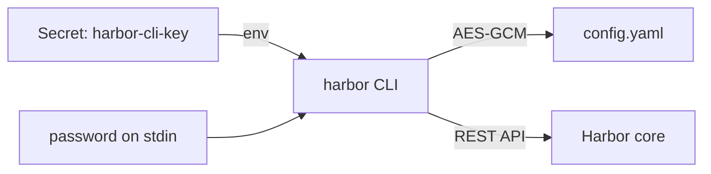

# The harbor CLI In A Script

A command you type yourself can ask you a question, and you answer it. A command in a pipeline cannot: there is no person and no terminal, so a question either hangs the job until it times out or fails it with an error that is hard to read. This part shows how the `harbor` command-line tool (CLI) keeps its sign-in, how to sign it in without a prompt, and how a script reads the answers the CLI gives back.

## Where the CLI keeps its sign-in

The CLI does not ask for a password on every command. It signs in once and saves the result as a **context**: a name, the Harbor server address, the user name and the password. All contexts live in one configuration file, by default `~/.config/harbor-cli/config.yaml`, and one of them is the current context that every command uses.

The workstation pod already has one context, called `admin`, that the bootstrap created. List the contexts the CLI knows:

<!-- astrona:playground:renew -->

```sh
ws harbor context list
```

The list shows the context `admin` for the user `admin` at `https://harbor.localtest.me:8443`, marked as the current one. Now look at the file behind it:

```sh
ws cat /root/.config/harbor-cli/config.yaml
```

The file has the key `current-credential-name` and a list `credentials`, with one entry holding `name`, `username`, `password` and `serveraddress`. The password is not readable: it is a Base64 string of encrypted bytes. The CLI encrypts saved passwords with AES-GCM, a standard encryption algorithm, and it needs a key to do so.

## The encryption key in a container

The CLI looks for that key in three places, in this order. First it reads the environment variable `HARBOR_ENCRYPTION_KEY`. If that is not set, it uses the operating system's keyring, the protected store for secrets that macOS, Windows and Linux desktops provide. A container has no such keyring, so without the variable the CLI falls back to a key file under `~/.harbor/keyring/` and prints a warning; the CLI documentation calls this fallback less secure. For containers and CI jobs, set `HARBOR_ENCRYPTION_KEY`.

The workstation pod gets its key from the Kubernetes Secret `harbor-cli-key`, which the bootstrap filled with 32 random bytes. Check that the variable is set, without printing it:

```sh
ws sh -c 'test -n "$HARBOR_ENCRYPTION_KEY" && echo "HARBOR_ENCRYPTION_KEY is set"'
```

The command prints the confirmation line. This is the pattern for a pipeline: the key comes from the CI system's secret store, so the configuration file on the runner is useless to anyone who copies it without the key.



The diagram shows the CLI taking the password from standard input and the key from the environment, writing only the encrypted password to its configuration file, and then calling Harbor's API.

## Signing in without a prompt

`harbor login` takes the server address as its argument, the user name with `-u` and the context name with `-n`. It can take the password with `-p`, but then the password sits in the command line, where the shell history and the process list can show it. The CLI's own help text recommends `--password-stdin`, which reads the password from standard input.

Sign in a second time, as the user `demo-dev` (lab-only password `Demo-Dev-2026`), into a new context:

```sh
printf '%s' 'Demo-Dev-2026' | ws harbor login https://harbor.localtest.me:8443 -u demo-dev --password-stdin -n demo-dev
```

`harbor login` checks the user name and password against Harbor before it saves anything, so a wrong password fails here and not three commands later. The new context `demo-dev` is now the current one. List projects as that user, then switch back to the administrator:

```sh
ws harbor project list
ws harbor context switch admin
```

As `demo-dev`, the list shows only `library`, the public project every new Harbor has. `inventory` is missing, because it is private and `demo-dev` is not a member. Every command you run from here on uses the `admin` context again.

## Commands that wait for input

Many CLI commands have an interactive mode. If you leave out an argument the command needs, for example the project name of `harbor project member list` or the flags of `harbor webhook create`, the CLI opens a form and waits for you to choose. In a terminal that is helpful. In a pipeline the command either waits forever or stops with an error about the missing terminal.

Two habits keep a script safe. First, always give every argument and flag the command needs. Second, give each command an empty standard input with `</dev/null`, so a prompt fails at once instead of waiting:

```sh
ws sh -c 'harbor project member list inventory </dev/null'
```

The command lists the members of `inventory`, which is only the administrator. The `</dev/null` changes nothing when the command has what it needs; it only matters when it does not.

## Reading the answers: JSON and exit codes

A script has two ways to learn what happened: the output and the exit code. The global flag `-o json` (`--output-format`) makes a command print JSON instead of a table, and `jq` reads it. Ask for the projects as JSON and pick out their names:

```sh
ws sh -c 'harbor project list -o json </dev/null | jq -r ".. | objects | select(has(\"name\") and has(\"project_id\")) | .name"'
```

The output is the project names, one per line: `library` (the project every new Harbor has) and `inventory`. The filter uses `..` to search the whole JSON document for objects that look like projects, so it does not depend on how the CLI wraps the list.

The exit code is the second answer. A command that succeeds exits with `0`, and one that fails exits with another number. `kubectl exec` passes the exit code of the command in the pod back to your shell, so you can test it directly:

```sh
ws harbor project view inventory </dev/null >/dev/null 2>&1; echo "inventory: exit $?"
ws harbor project view no-such-project </dev/null >/dev/null 2>&1; echo "no-such-project: exit $?"
```

The first line prints exit `0` and the second a non-zero exit code. That is all a script needs to decide whether to create the project.

You now know where the CLI keeps its sign-in, how to sign in without a prompt, why a container needs `HARBOR_ENCRYPTION_KEY`, and how to read a command's JSON and exit code. The open question is how to combine these into a script that creates only what is missing, so that running it twice is safe.

## Common pitfalls

> [!WARNING]
> - **Passing the password with `-p` in a script.** It ends up in the shell history, the process list and the CI log. Use `--password-stdin` and read the password from a secret.
> - **Leaving out an argument.** The command opens an interactive form and the pipeline hangs. Give every argument and flag, and add `</dev/null`.
> - **Running the CLI in a container without `HARBOR_ENCRYPTION_KEY`.** The CLI falls back to a key file under `~/.harbor/keyring/` and prints a warning. Inject the key from a secret store instead.
> - **Parsing the table output with `grep` or `awk`.** Tables change between releases. Use `-o json` and `jq`.
> - **Forgetting which context is current.** A login switches the current context. Run `harbor context list` when a command answers as the wrong user.
