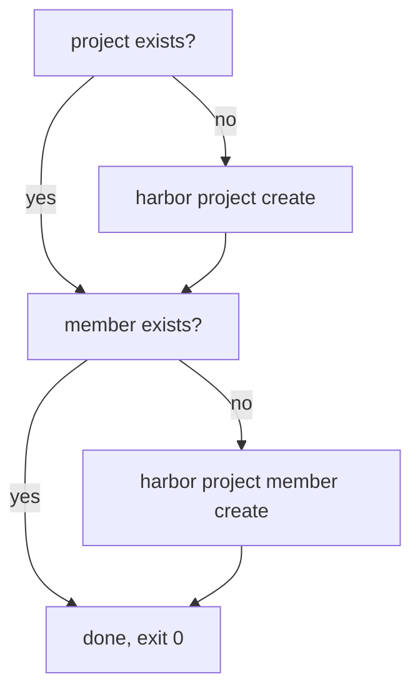

# An Onboarding Script That Can Run Twice

A pipeline step can run more than once: a job is retried after a network error, two pull requests trigger the same job, or someone runs it again to be sure. A script that creates a project with `harbor project create` fails on the second run, because the project already exists. This part builds a script that checks before it creates, so a second run changes nothing and still succeeds.

## The rule: check, then create

A script is **idempotent** when running it twice gives the same result as running it once. For a script that creates objects, the rule is simple: for every object, ask Harbor whether it exists, and create it only if it does not. The answer comes from the two things a command gives back, its exit code and its JSON output.



The diagram shows the order: each object is checked, created only when missing, and the script ends with exit code `0` either way.

## The project: use the exit code

`harbor project view <name>` exits with `0` when the project exists and with another code when it does not. That makes the project check one `if`. `harbor project create <name> --storage-limit -1` creates a private project, which only its members can see, because `--public` is missing. The flag `--storage-limit -1` sets no storage limit, and a script needs it: the CLI skips its interactive form only when it gets both the project name and `--storage-limit`, so without the flag the command fails without a terminal.

## The membership: use the JSON

`harbor project member list <project>` succeeds whether or not the user is a member, so its exit code says nothing about the user. The answer is in the output. With `-o json`, every member appears as an object with the field `entity_name`, which holds the user or group name. `jq -e` exits with `0` when its filter is true and with `1` when it is false, so it turns "is this name in the list" into an exit code:

```sh
jq -e --arg u "$username" '[.. | objects | select(.entity_name? == $u)] | length > 0'
```

`harbor project member create <project> --username <user> --role Developer` adds the user with the Developer role, which can push and pull in that project. The role names the CLI accepts are `Project_Admin`, `Maintainer`, `Developer`, `Guest` and `Limited_Guest`.

## The script

<!-- astrona:playground:renew -->

Save this as `onboard-member.sh` on your machine:

```sh
#!/bin/sh
# onboard-member.sh PROJECT USERNAME
# Creates a private project and gives an existing user the Developer role in
# it, each only if it is missing, so the script can run again safely.
set -eu
project="$1"
username="$2"

if harbor project view "$project" </dev/null >/dev/null 2>&1; then
  echo "project $project exists"
else
  harbor project create "$project" --storage-limit -1 </dev/null
  echo "project $project created"
fi

if harbor project member list "$project" --page-size 100 -o json </dev/null \
    | jq -e --arg u "$username" '[.. | objects | select(.entity_name? == $u)] | length > 0' >/dev/null; then
  echo "$username is already a member of $project"
else
  harbor project member create "$project" --username "$username" --role Developer </dev/null
  echo "$username added to $project as Developer"
fi
```

`set -eu` stops the script at the first command that fails and at the first variable that is not set, so a failed create never looks like success. Every `harbor` command gets `</dev/null`, so none of them can wait for input.

Copy the script into the workstation pod:

```sh
ws sh -c 'cat > /work/onboard-member.sh' < onboard-member.sh
```

Then run it the way a pipeline would: no terminal, standard input from `/dev/null`. It onboards the existing user `demo-dev` into a new project `team-demo`:

```sh
ws sh -c 'sh /work/onboard-member.sh team-demo demo-dev </dev/null'; echo "exit $?"
```

The script prints that it created the project `team-demo` and added `demo-dev` as a Developer, and the exit code is `0`. Now run exactly the same command a second time:

```sh
ws sh -c 'sh /work/onboard-member.sh team-demo demo-dev </dev/null'; echo "exit $?"
```

This time it prints that the project exists and that `demo-dev` is already a member, and the exit code is still `0`. Check the result from Harbor's side:

```sh
ws harbor project member list team-demo </dev/null
```

The list shows `demo-dev` once, with the role Developer, next to the administrator who created the project. The second run changed nothing, which is exactly what idempotent means.

## What the script does not do yet

The script assumes the user exists. A real onboarding script also creates the user when it is missing, with `harbor user create --username ... --email ... --realname ... --password ...`. Whether a user exists is again a question for the JSON: `harbor user list --page-size 0 -o json` lists every user (`0` means all pages), and each user object has the field `username`. The new user's password must not be written in the script; read it from an environment variable that the pipeline fills from its secret store.

You can now write a CLI script that checks before it creates, reads exit codes and JSON, and never waits for input. What is left is to extend it to the user, and to prove it with two runs in a row.

## Common pitfalls

> [!WARNING]
> - **Testing a list command's exit code.** `member list` and `user list` succeed whether or not the name is there. Test the JSON with `jq -e`, not the exit code.
> - **Matching names with `grep`.** `grep red-dev` also matches `red-dev2`. Compare the exact field with `jq`.
> - **Leaving out `set -eu`.** Without it, a failed create is followed by "created" and exit code `0`.
> - **Using the wrong role name.** The CLI accepts `Developer`, not `Developers` or `developer`.
> - **Testing only once.** A script is idempotent only if the second run succeeds too. Always run it twice.

## Your mission: Write An Idempotent Onboarding Script

You can now build a CLI script that creates only what is missing and prove it with two runs. The graded lab asks you to write `onboard.sh`, which onboards a team in one go: a private project, a new user with a password from the environment, and a Developer membership, and which must succeed when everything already exists.

The lab runs in its own cluster, so first pause your playground. Nothing in it is lost:

```sh
astrona stop ats-104-playground-010-01
```

Then start the lab:

```sh
astrona run --git ssh://git@github.com/astrona-io/ATS104.git -c sections/section-010/module-01/labs/lab-01
```

The task is on the next page. Solve it on your own first. When you think you are done, send it for grading:

```sh
astrona submit -c sections/section-010/module-01/labs/lab-01
```

When the lab is done, remove it and start your playground again:

```sh
astrona destroy ats-104-lab-010-01
astrona start ats-104-playground-010-01
```
