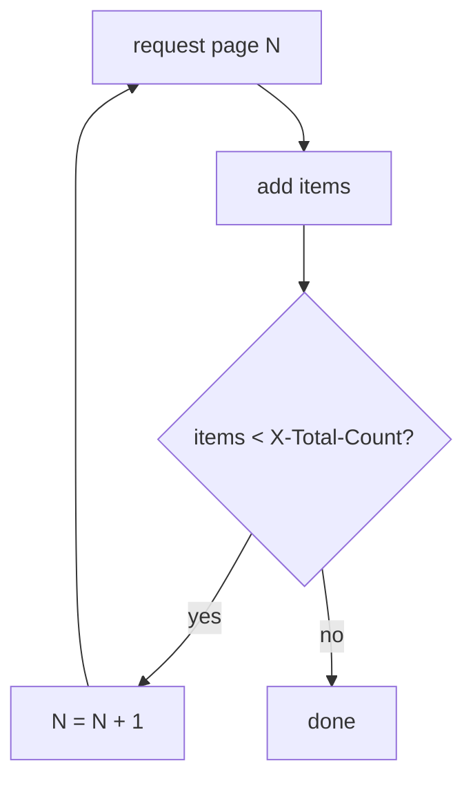

# Pages, Filters And Sorting

A list endpoint never returns everything at once. Harbor splits long lists into pages, and a script that reads only the first page silently works on part of the data. This part shows where Harbor says how long the list really is, how to ask for the next page, and how to let the server filter and sort the list so the script receives only what it needs.

## The first page is not the whole list

The project `inventory` has twelve repositories. Ask for them with the default settings and count what comes back:

<!-- astrona:playground:renew -->

```sh
ws sh -c 'curl -s -u admin:Harbor12345 "$HARBOR_URL/api/v2.0/projects/inventory/repositories" | jq length'
```

The answer is `10`, not `12`. The response is a valid list, and nothing in the body says that two repositories are missing. The default page size of every list endpoint is `10`.

## The headers that tell the truth

The information a script needs is in the response headers. Print only the headers of the same request with `-D -` (dump headers to standard output) and drop the body:

```sh
ws sh -c 'curl -s -D - -o /dev/null -u admin:Harbor12345 "$HARBOR_URL/api/v2.0/projects/inventory/repositories" | grep -iE "^(x-total-count|link):"'
```

Two headers matter:

| Header | What it holds |
| --- | --- |
| `X-Total-Count` | The total number of items on all pages together, here `12` |
| `Link` | The URLs of the next and previous pages, each marked with `rel="next"` or `rel="prev"` |

On the first page, `Link` points to page `2` with `rel="next"`. On the last page there is no `rel="next"`. A script can follow `Link` until `rel="next"` is gone, or count the items it has and stop when it reaches `X-Total-Count`. Both work; counting is simpler to write.

## Asking for a page and a page size

Two query parameters choose the page: `page` (starting at `1`) and `page_size` (the number of items per page, at most `100`). Ask for the second page with the default size:

```sh
ws sh -c 'curl -s -u admin:Harbor12345 "$HARBOR_URL/api/v2.0/projects/inventory/repositories?page=2&page_size=10" | jq -r ".[].name"'
```

The answer is the two repositories the first page left out. A larger `page_size` reduces the number of requests, but it does not remove the need to page: at most `100` items come back per request, and a project can hold thousands of repositories. Write the loop once and the size does not matter.



The diagram shows the loop a script runs: request a page, add its items, and request the next page until it holds as many items as `X-Total-Count` says exist.

## Filtering on the server with q

Often a script needs only some items. The `q` parameter filters the list on the server, so less data travels and fewer pages exist. Its patterns are:

| Pattern | Meaning | Example |
| --- | --- | --- |
| `key=value` | Exact match | `q=name=inventory/notes-01` |
| `key=~value` | Fuzzy match (contains) | `q=name=~notes-1` |
| `key=[min~max]` | Range | `q=creation_time=[2026-01-01 00:00:00~2026-12-31 23:59:59]` |
| `key={v1 v2}` | Any of the values | `q=name={inventory/notes-01 inventory/notes-02}` |

Several conditions go in one `q`, separated by commas. The value contains characters such as `=` and `~` that must be URL-encoded. `curl -G --data-urlencode` does that for you and adds the result to the URL of a `GET` request:

```sh
ws sh -c 'curl -s -G -u admin:Harbor12345 --data-urlencode "q=name=~notes-1" "$HARBOR_URL/api/v2.0/projects/inventory/repositories" | jq -r ".[].name"'
```

The answer is the repositories whose names contain `notes-1`: `notes-10`, `notes-11` and `notes-12`. Which keys a list accepts in `q` is written in the Swagger file for each endpoint; for repositories, `name` works.

## Sorting

The `sort` parameter orders the list on the server. It takes field names separated by commas; a minus sign in front of a name means descending order. Ask for the three most recently created repositories:

```sh
ws sh -c 'curl -s -G -u admin:Harbor12345 --data-urlencode "sort=-creation_time" --data-urlencode "page_size=3" "$HARBOR_URL/api/v2.0/projects/inventory/repositories" | jq -r ".[].name"'
```

The answer is three repository names, newest first. Sorting on the server matters with paging: if a script sorts each page by itself, the order across pages is wrong.

## Path names that contain a slash

A repository name can contain slashes, for example `charts/podinfo` in a project. In an API path, Harbor needs that name URL-encoded twice: `charts/podinfo` becomes `charts%252Fpodinfo`. The repositories in this playground have no slash, so their names go into paths unchanged, but a script that handles any repository must encode them.

You can now find the real length of a list, read it page by page, and let the server filter and sort it. The last step is to put this into a script that runs on its own, with TLS verification on.

## Common pitfalls

> [!WARNING]
> - **Reading only the first page.** The default page size is `10`, and the body gives no hint that more exist. Always check `X-Total-Count` or `Link`.
> - **Relying on a large `page_size` instead of a loop.** The maximum is `100`; a bigger project needs more pages anyway.
> - **Building the `q` value by hand.** Unencoded `=`, `~`, spaces and brackets break the request. Use `--data-urlencode` or a URL-encoding function.
> - **Sorting each page on the client.** The order across pages is then wrong. Use `sort` on the server.
> - **Passing a repository name with a slash unencoded.** It must be encoded twice in the path.
