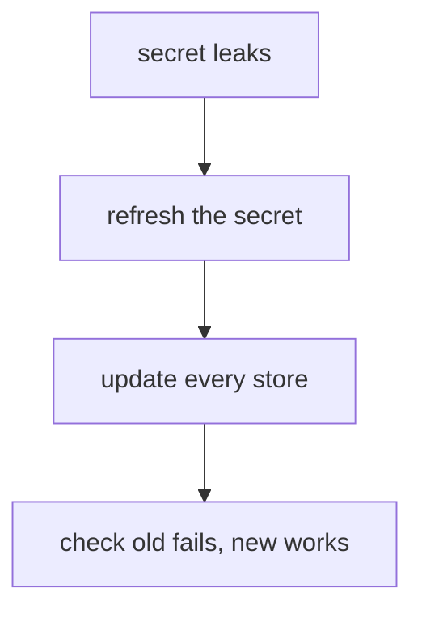

# Rotating A Robot Secret

A leaked secret is a certainty over a long enough time, so the response must be quick and must not break the pipeline for longer than it has to. The response is to rotate the secret: replace it with a new one so the old one stops working, while the robot keeps its ID, its name and its permissions. This part creates a robot, rotates its secret through the API, proves the old secret is dead, and changes the robot's permissions and lifetime in place.

## Why rotate in place

**Rotating** a secret means replacing it with a new one so the old one stops working. Harbor calls this refreshing. A tempting alternative is to delete the robot and create it again with the same name. That gives a new ID, and the audit history and any automation that refers to the ID stop matching. Refreshing keeps all of that and changes only the secret.



The diagram shows the order of a rotation: refresh in Harbor, update every place that holds the secret, and then check both secrets.

## Create a robot to rotate

Create a pull-only robot called `rotator` in `inventory`, with a 30-day lifetime. Save this as `robot-rotator.json` on your machine:

<!-- astrona:playground:renew -->

```json
{
  "name": "rotator",
  "description": "A robot whose secret is rotated",
  "level": "project",
  "duration": 30,
  "permissions": [
    {
      "kind": "project",
      "namespace": "inventory",
      "access": [
        {"resource": "repository", "action": "pull"}
      ]
    }
  ]
}
```

Create it, and put its name and secret straight into a Kubernetes Secret, so the secret never appears on your screen:

```sh
RESPONSE="$(ws sh -c 'curl -s -u admin:Harbor12345 -H "Content-Type: application/json" --data-binary @- "$HARBOR_URL/api/v2.0/robots"' < robot-rotator.json)"
kubectl -n workstation create secret generic inventory-rotator \
  --from-literal=username="$(printf '%s' "$RESPONSE" | ws jq -r '.name')" \
  --from-literal=password="$(printf '%s' "$RESPONSE" | ws jq -r '.secret')"
```

The Secret `inventory-rotator` now holds `username` (`robot$inventory+rotator`) and `password`. Read the values back the way a job would:

```sh
ROBOT_NAME="$(kubectl -n workstation get secret inventory-rotator -o jsonpath='{.data.username}' | base64 -d)"
ROBOT_SECRET="$(kubectl -n workstation get secret inventory-rotator -o jsonpath='{.data.password}' | base64 -d)"
```

The variable `$ROBOT_NAME` is used in double quotes below, so your shell does not expand the `$inventory` inside its value.

## Refresh the secret

`PATCH /api/v2.0/robots/<id>` with a body `{"secret": "<new secret>"}` sets a new secret that you choose. It must be 8 to 128 characters with an uppercase letter, a lowercase letter and a digit. The `harbor` CLI does the same with `harbor project robot refresh <id>`, which lets Harbor generate a random secret, or takes yours with `--secret-stdin`.

Find the robot's ID, and refresh its secret:

```sh
ROBOT_ID="$(ws sh -c 'curl -s -u admin:Harbor12345 "$HARBOR_URL/api/v2.0/robots?page_size=100&q=Level=project,ProjectID=$(curl -s -u admin:Harbor12345 "$HARBOR_URL/api/v2.0/projects/inventory" | jq .project_id)"' | ws jq -r '.[] | select(.name == "robot$inventory+rotator") | .id')"
ws sh -c "curl -s -o /dev/null -w '%{http_code}\n' -u admin:Harbor12345 -X PATCH -H 'Content-Type: application/json' -d '{\"secret\":\"Rotator-Rotated-2026\"}' \"\$HARBOR_URL/api/v2.0/robots/$ROBOT_ID\""
```

The `PATCH` returns `200`. The old secret, still in the Secret `inventory-rotator` and in `$ROBOT_SECRET`, now fails:

```sh
printf '%s' "$ROBOT_SECRET" | ws oras login --registry-config /tmp/old.json -u "$ROBOT_NAME" --password-stdin harbor.localtest.me:8443 || echo "old secret: refused"
```

The login fails and prints `old secret: refused`. The robot kept its ID, name and permissions; only the secret changed.

## Update every store, then check

The last step of every rotation is to update every place that holds the secret, here the Kubernetes Secret. Until that is done, every job that reads the Secret fails. Update it, then sign in with the new value:

```sh
kubectl -n workstation create secret generic inventory-rotator \
  --from-literal=username="$ROBOT_NAME" --from-literal=password='Rotator-Rotated-2026' \
  --dry-run=client -o yaml | kubectl apply -f -
printf '%s' 'Rotator-Rotated-2026' | ws oras login --registry-config /tmp/new.json -u "$ROBOT_NAME" --password-stdin harbor.localtest.me:8443
```

The login with the new secret succeeds. A pod that mounted the Secret as an environment variable keeps the old value until it restarts, while a mounted file updates after a short delay, so a real rotation also restarts the workloads that read the Secret as a variable.

## Change permissions or lifetime in place

Changing a robot's permissions or duration goes through `PUT /api/v2.0/robots/<id>` with the whole robot object: read it with `GET`, change `permissions` or `duration`, and send it back. Harbor replaces the robot's settings with what you send, so a `PUT` with a partial object can remove what you left out. The `harbor project robot update <id>` command offers the same for a script, for example `--duration 180`. Neither route changes the secret: the secret changes only when you refresh it.

You can now replace a robot's secret without recreating the robot, update the stores that hold it, prove the old secret is dead, and change a robot's permissions or lifetime in place. Together with least privilege and an expiry, these keep the cost of a leaked secret small and the response to it fast.

## Common pitfalls

> [!WARNING]
> - **Deleting and recreating a robot to "rotate" it.** Its ID changes, and audit history and any automation that refers to the ID break. Refresh the secret instead.
> - **Rotating without updating the stores.** Every job that holds the old secret fails. List where the secret lives before you rotate.
> - **Sending a partial object with `PUT`.** Fields you leave out can be reset. Always start from the `GET` response.
> - **Expecting an update to change the secret.** `PUT` and `harbor project robot update` leave the secret as it is.
