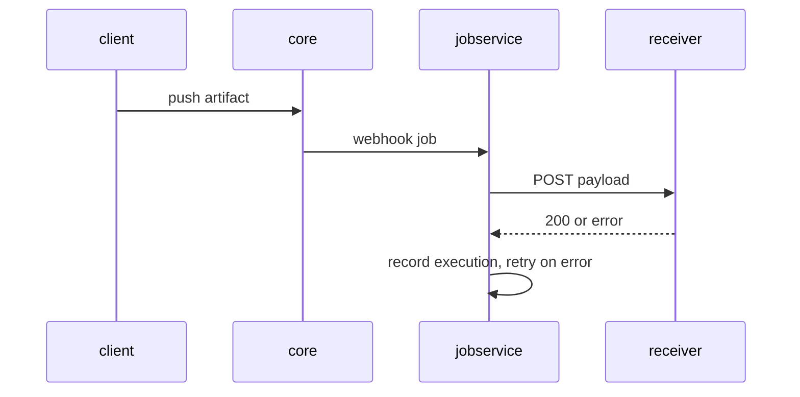

# Delivery, Retries And CI Integration

A webhook that does not arrive gives no error anywhere you would look: the push succeeded, the policy is enabled, and the pipeline simply never starts. To find out what happened, you need to know which Harbor component sends webhooks, where it records each attempt, and how it retries. This part breaks a delivery on purpose, reads why it failed, and then connects Harbor's webhooks to real CI systems.

## Who sends the request

The component that pushes your artifact is not the one that sends the webhook. When `core` records an event that matches a policy, it hands a webhook job to **`jobservice`**, Harbor's component for background work. `jobservice` sends the HTTP request, waits for an answer, and retries when the request fails or the endpoint answers with a status outside the `2xx` range. Every attempt is stored as an **execution** of the policy, with one **task** per target and a log per task.



The diagram shows the push and the webhook as two separate steps: the client's push finishes before `jobservice` sends anything, which is why a failed webhook never fails the push.

## Break a delivery on purpose

The receiver also listens on HTTPS, port `8443`, with a self-signed certificate that Harbor does not trust. Create a policy for that endpoint with certificate verification on. Save this as `webhook-policy-https.json` on your machine:

<!-- astrona:playground:renew -->

```json
{
  "name": "notify-https",
  "description": "Push events over HTTPS",
  "enabled": true,
  "event_types": ["PUSH_ARTIFACT"],
  "targets": [
    {
      "type": "http",
      "address": "https://echo.hooks.svc.cluster.local:8443/secure",
      "auth_header": "Bearer demo-token",
      "skip_cert_verify": false,
      "payload_format": "Default"
    }
  ]
}
```

Create it and push an artifact:

```sh
ws sh -c 'curl -s -o /dev/null -w "%{http_code}\n" -u admin:Harbor12345 -H "Content-Type: application/json" --data-binary @- "$HARBOR_URL/api/v2.0/projects/inventory/webhook/policies"' < webhook-policy-https.json
ws sh -c 'cd /tmp && echo https > https.txt && oras push harbor.localtest.me:8443/inventory/https-test:v1 https.txt'
```

The policy is created with `201` and the push succeeds. Nothing reaches the receiver's path `/secure`.

## Read the executions and the task log

The REST API exposes each policy's executions under `/projects/<project>/webhook/policies/<id>/executions`, each execution's tasks under `.../executions/<id>/tasks`, and each task's log under `.../tasks/<id>/log`. The portal shows the same under the project's **Webhooks** tab. Find the policy's ID and its latest execution:

```sh
POLICY_ID="$(ws sh -c 'curl -s -u admin:Harbor12345 "$HARBOR_URL/api/v2.0/projects/inventory/webhook/policies"' | ws jq -r '.[] | select(.name == "notify-https") | .id')"
ws sh -c "curl -s -u admin:Harbor12345 \"\$HARBOR_URL/api/v2.0/projects/inventory/webhook/policies/$POLICY_ID/executions\"" | ws jq '.[0] | {id, status, start_time, end_time}'
```

The latest execution has the status `Running` while `jobservice` is still retrying, and `Error` once it has given up. Read its task log:

```sh
EXECUTION_ID="$(ws sh -c "curl -s -u admin:Harbor12345 \"\$HARBOR_URL/api/v2.0/projects/inventory/webhook/policies/$POLICY_ID/executions\"" | ws jq -r '.[0].id')"
TASK_ID="$(ws sh -c "curl -s -u admin:Harbor12345 \"\$HARBOR_URL/api/v2.0/projects/inventory/webhook/policies/$POLICY_ID/executions/$EXECUTION_ID/tasks\"" | ws jq -r '.[0].id')"
ws sh -c "curl -s -u admin:Harbor12345 \"\$HARBOR_URL/api/v2.0/projects/inventory/webhook/policies/$POLICY_ID/executions/$EXECUTION_ID/tasks/$TASK_ID/log\""
```

The log shows the request to `https://echo.hooks.svc.cluster.local:8443/secure` and an error from the TLS handshake: the certificate is signed by an authority Harbor does not know. That is the answer to "why did my webhook not arrive", and no other place shows it.

There are two correct fixes, and both are decisions, not workarounds. Inside a cluster, a plain HTTP endpoint on the cluster network is often acceptable, and the auth header still proves the sender. For an endpoint outside the cluster, use a certificate from an authority Harbor trusts. Setting `skip_cert_verify` to `true` makes the delivery work, but then Harbor sends the auth header to whoever answers at that address, so use it only for endpoints you control on a network you trust.

## Retries and timeouts

`jobservice` retries a failed webhook a limited number of times, with a timeout for each request. Both are set when Harbor is installed. With the `harbor-helm` chart they are `jobservice.notification.webhook_job_max_retry` and `jobservice.notification.webhook_job_http_client_timeout` (in seconds); with the Docker Compose installer they sit under `notification:` in `harbor.yml`. The documentation's example uses 3 retries and a 3-second timeout. More retries mean more load on the job queue, and a slow receiver should answer at once and do its work afterwards instead of raising the timeout.

## Connecting to CI systems

A CI system receives Harbor's webhook in one of two ways.

Jenkins, with the Generic Webhook Trigger plugin, accepts any JSON POST at `/generic-webhook-trigger/invoke` and maps fields of the body into job variables with JSONPath expressions, for example `$.event_data.resources[0].resource_url` from a Default payload. A token in the URL or a header selects the job. Harbor's endpoint is then the Jenkins URL, and the auth header can carry the token.

GitHub Actions starts a workflow on a `repository_dispatch` event, which GitHub accepts only in its own format, `{"event_type": "...", "client_payload": {...}}`, with a GitHub token. Harbor's payload does not have that shape, so a small relay sits between them: it receives Harbor's webhook, checks the auth header, and calls GitHub's API with the artifact's details in `client_payload`. The workflow then reads them:

```yaml
on:
  repository_dispatch:
    types: [harbor-artifact-pushed]
jobs:
  deploy:
    runs-on: ubuntu-latest
    steps:
      - run: echo "Deploying ${{ github.event.client_payload.resource_url }}"
```

The same relay pattern works for any system that wants its own request format: Harbor sends one well-known payload, and a small piece of code translates it.

You can now follow a webhook from the push through `jobservice` to the receiver, read why a delivery failed from the task log, choose between the fixes for an untrusted certificate, and connect Harbor to Jenkins and GitHub Actions.

## Common pitfalls

> [!WARNING]
> - **Looking for webhook errors in the push.** The push succeeds whatever happens to the webhook. Read the policy's executions and task logs.
> - **Turning on `skip_cert_verify` everywhere.** Harbor then sends the auth header to any server at that address. Use a trusted certificate or a cluster-internal HTTP endpoint.
> - **A receiver that does its work before answering.** It times out, `jobservice` retries, and the pipeline starts twice. Answer at once, then work.
> - **Pointing Harbor straight at GitHub's dispatch API.** The payload has the wrong shape. Use a relay.
> - **Reading the receiver log once.** Delivery takes a moment; wait and read again.

## Your mission: Notify A Pipeline When An Artifact Is Pushed

You can now create a webhook policy, prove its delivery, and debug a delivery that fails. The graded lab asks you to create the policy `notify-ci` in `inventory`, which sends `PUSH_ARTIFACT` events in the Default format to the receiver with the auth header `Bearer pipeline-token-123`, and to prove that a push reaches it.

The lab runs in its own cluster, so first pause your playground. Nothing in it is lost:

```sh
astrona stop ats-104-playground-040-01
```

Then start the lab:

```sh
astrona run --git ssh://git@github.com/astrona-io/ATS104.git -c sections/section-040/module-01/labs/lab-01
```

The task is on the next page. Solve it on your own first. When you think you are done, send it for grading:

```sh
astrona submit -c sections/section-040/module-01/labs/lab-01
```

When the lab is done, remove it and start your playground again:

```sh
astrona destroy ats-104-lab-040-01
astrona start ats-104-playground-040-01
```
