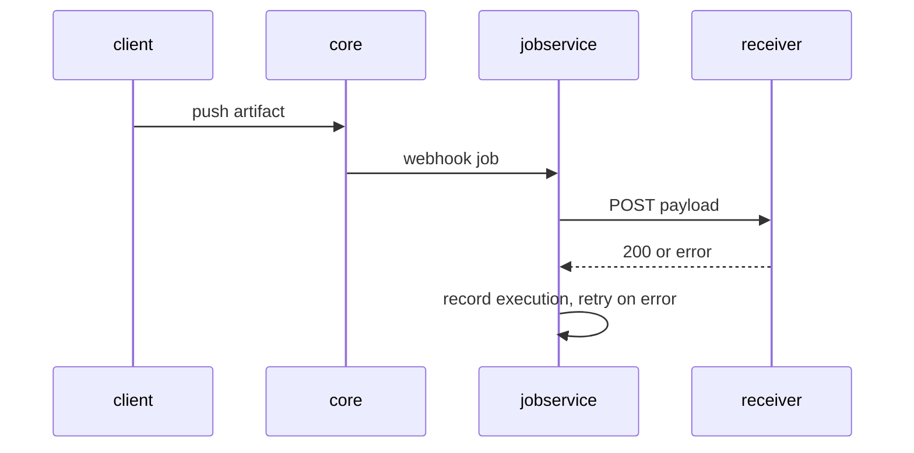

# Reading A Failed Delivery

A webhook that does not arrive gives no error anywhere you would look: the push succeeded, the policy is enabled, and the pipeline simply never starts. To find out what happened, you need to know which Harbor component sends webhooks, where it records each attempt, and how it retries. This part breaks a delivery on purpose, reads why it failed, and then connects Harbor's webhooks to real CI systems.

## Who sends the request

The component that pushes your artifact is not the one that sends the webhook. When `core` records an event that matches a policy, it hands a webhook job to **`jobservice`**, Harbor's component for background work. `jobservice` sends the HTTP request, waits for an answer, and retries when the request fails or the endpoint answers with a status outside the `2xx` range. Every attempt is stored as an **execution** of the policy, with one **task** per target and a log per task.



The diagram shows the push and the webhook as two separate steps: the client's push finishes before `jobservice` sends anything, which is why a failed webhook never fails the push.

## Break a delivery on purpose

The receiver also listens on HTTPS, port `8443`, with a self-signed certificate that Harbor does not trust. Create a policy for that endpoint with certificate verification on. Save this as `webhook-policy-https.json` on your machine:

<!-- astrona:playground:renew -->

```json
{
  "name": "notify-https",
  "description": "Push events over HTTPS",
  "enabled": true,
  "event_types": ["PUSH_ARTIFACT"],
  "targets": [
    {
      "type": "http",
      "address": "https://echo.hooks.svc.cluster.local:8443/secure",
      "auth_header": "Bearer demo-token",
      "skip_cert_verify": false,
      "payload_format": "Default"
    }
  ]
}
```

Create it and push an artifact:

```sh
ws sh -c 'curl -s -o /dev/null -w "%{http_code}\n" -u admin:Harbor12345 -H "Content-Type: application/json" --data-binary @- "$HARBOR_URL/api/v2.0/projects/inventory/webhook/policies"' < webhook-policy-https.json
ws sh -c 'cd /tmp && echo https > https.txt && oras push harbor.localtest.me:8443/inventory/https-test:v1 https.txt'
```

The policy is created with `201` and the push succeeds. Nothing reaches the receiver's path `/secure`.

## Read the executions and the task log

The REST API exposes each policy's executions under `/projects/<project>/webhook/policies/<id>/executions`, each execution's tasks under `.../executions/<id>/tasks`, and each task's log under `.../tasks/<id>/log`. The portal shows the same under the project's **Webhooks** tab. Find the policy's ID and its latest execution:

```sh
POLICY_ID="$(ws sh -c 'curl -s -u admin:Harbor12345 "$HARBOR_URL/api/v2.0/projects/inventory/webhook/policies"' | ws jq -r '.[] | select(.name == "notify-https") | .id')"
ws sh -c "curl -s -u admin:Harbor12345 \"\$HARBOR_URL/api/v2.0/projects/inventory/webhook/policies/$POLICY_ID/executions\"" | ws jq '.[0] | {id, status, start_time, end_time}'
```

The latest execution has the status `Running` while `jobservice` is still retrying, and `Error` once it has given up. Read its task log:

```sh
EXECUTION_ID="$(ws sh -c "curl -s -u admin:Harbor12345 \"\$HARBOR_URL/api/v2.0/projects/inventory/webhook/policies/$POLICY_ID/executions\"" | ws jq -r '.[0].id')"
TASK_ID="$(ws sh -c "curl -s -u admin:Harbor12345 \"\$HARBOR_URL/api/v2.0/projects/inventory/webhook/policies/$POLICY_ID/executions/$EXECUTION_ID/tasks\"" | ws jq -r '.[0].id')"
ws sh -c "curl -s -u admin:Harbor12345 \"\$HARBOR_URL/api/v2.0/projects/inventory/webhook/policies/$POLICY_ID/executions/$EXECUTION_ID/tasks/$TASK_ID/log\""
```

The log shows the request to `https://echo.hooks.svc.cluster.local:8443/secure` and an error from the TLS handshake: the certificate is signed by an authority Harbor does not know. That is the answer to "why did my webhook not arrive", and no other place shows it.

There are two correct fixes, and both are decisions, not workarounds. Inside a cluster, a plain HTTP endpoint on the cluster network is often acceptable, and the auth header still proves the sender. For an endpoint outside the cluster, use a certificate from an authority Harbor trusts. Setting `skip_cert_verify` to `true` makes the delivery work, but then Harbor sends the auth header to whoever answers at that address, so use it only for endpoints you control on a network you trust.


You can now follow a webhook from the push through `jobservice` to the receiver, and read why a delivery failed from the execution and the task log. The open question is how often `jobservice` tries again, and how a receiver should behave so that retries do no harm.

## Common pitfalls

> [!WARNING]
> - **Looking for webhook errors in the push.** The push succeeds whatever happens to the webhook. Read the policy's executions and task logs.
> - **Turning on `skip_cert_verify` everywhere.** Harbor then sends the auth header to any server at that address. Use a trusted certificate or a cluster-internal HTTP endpoint.
> - **Reading the receiver log once.** Delivery takes a moment; wait and read again.
