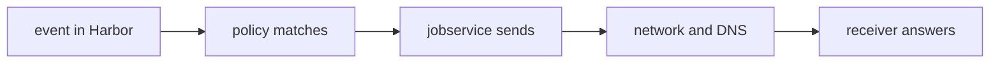

# Troubleshooting A Webhook That Does Not Arrive

The report is always the same: "Harbor should have told us, and it did not." The cause is somewhere between the event and the receiver's log. Work along the path in order and stop at the first step that fails.

## The path of a webhook



The diagram shows the five steps. A failure at each one leaves a different trace.

## Step 1: Did the event happen

Check that the action took place in the project that holds the policy. A push to `other/notes` does not reach a policy in `inventory`. Read the project log:

```sh
ws sh -c 'curl -s -u admin:Harbor12345 "$HARBOR_URL/api/v2.0/projects/inventory/logs?page_size=5" | jq -r ".[] | [.op_time, .username, .operation, .resource] | @tsv"'
```

## Step 2: Does a policy match

Read the policies and check three things: `enabled` is true, `event_types` holds the event, and the policy is in the right project. Then read the last trigger:

```sh
ws sh -c 'curl -s -u admin:Harbor12345 "$HARBOR_URL/api/v2.0/projects/inventory/webhook/lasttrigger" | jq'
```

If the event type has no recent trigger time, the policy did not match, and the cause is in the policy: disabled, wrong event, wrong project. Fix it, then trigger the event again. Harbor does not send events that happened before the policy existed.

## Step 3: Did jobservice send it

If the last trigger is recent, a delivery was created. Read the executions of the policy, and the task log of the latest one, as the first module showed. The status `Error` and the log tell what jobservice saw: a connection error, a timeout, a TLS error or a status code from the receiver.

## Step 4: Can Harbor reach the address

The request leaves from the jobservice pod, not from your computer. An address that works from your laptop can fail from the cluster. Common causes:

| Symptom in the task log | Likely cause |
| --- | --- |
| Name resolution error | The host name does not exist in the cluster's DNS |
| Connection refused | Nothing listens on that port, or the service name is wrong |
| Timeout | A network policy or a firewall blocks the path |
| Certificate error | A self-signed or unknown certificate, with `skip_cert_verify` false |

Use the policy test request to try the address without waiting for a real event.

## Step 5: What did the receiver answer

If the task log shows a status code, the receiver answered. A `401` means the auth header differs from what the receiver expects, so compare the two strings character by character, including the word `Bearer` and any trailing space. A `5xx` status means the receiver failed, and its own log is the next place to look. A `2xx` status means Harbor did its part, and the problem is inside the receiver.

## Reading the receiver

In the lab, `receiver_log` prints the log of `echo`. In your own service, check that it logs every request at entry, before the auth check, at least for a while. A receiver that logs only after it accepts a request cannot tell you about the requests it rejected.

## A checklist

1. The action happened in the right project.
2. A policy exists, is enabled and lists the event.
3. `lasttrigger` shows a recent time for the event.
4. The latest execution has a status and a task log.
5. The address works from inside the cluster.
6. The receiver accepts the auth header and answers `2xx`.

## Your mission: Audit Deleted Artifacts With A CloudEvents Webhook

You can now choose events, manage policies, write a receiver and trace a webhook that does not arrive. The graded lab asks you to create the policy `audit-deletes` in the project `inventory`: it fires on `DELETE_ARTIFACT` only, sends CloudEvents to the receiver at `/audit` with the auth header `Bearer audit-token-456`, and is enabled.

The lab runs in its own cluster, so first pause your playground. Nothing in it is lost:

```sh
astrona stop ats-104-playground-040-02
```

Then start the lab:

```sh
astrona run --git ssh://git@github.com/astrona-io/ATS104.git -c sections/section-040/module-02/labs/lab-01
```

The task is on the next page. Solve it on your own first. When you think you are done, send it for grading:

```sh
astrona submit -c sections/section-040/module-02/labs/lab-01
```

When the lab is done, remove it and start your playground again:

```sh
astrona destroy ats-104-lab-040-02
astrona start ats-104-playground-040-02
```

## Common pitfalls

> [!WARNING]
> - **Testing from your laptop.** The request comes from the cluster. Test from inside it or with the policy test request.
> - **Expecting events from before the policy.** Harbor sends events from the moment the policy exists.
> - **Skipping steps.** Start at the event and move along the path. Guessing at the receiver first wastes time.
> - **Comparing the auth header by eye.** A missing `Bearer` or a trailing space is easy to miss.
